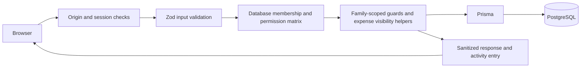

# FamilyBudget

FamilyBudget is a family budgeting app built with TanStack Start, React 19, TypeScript, Tailwind CSS, Prisma, PostgreSQL, Zod, and Recharts.

## Local development

1. Install dependencies with `npm install`.
2. Copy `.env.example` to `.env` and set `DATABASE_URL`, `DATABASE_URL_TEST`, and a random `JWT_SECRET` of at least 32 characters.
3. Generate Prisma Client and apply migrations:

   ```sh
   npx prisma generate
   npx prisma migrate deploy
   ```

4. Start the app with `npm run dev`.

Use PostgreSQL for both URLs and keep the test database separate from development data. Create the test database once before running tests:

```sql
CREATE DATABASE family_budget_test;
```

Set `DATABASE_URL_TEST` to that database. The Vitest global setup refuses a URL that resolves to the same database as `DATABASE_URL`, applies migrations once, and the integration suite truncates its tables between cases.

## Architecture and security

- PostgreSQL via Prisma is the only data layer.
- Registration creates a user, family, OWNER membership, and the eight default categories in one transaction.
- Login and registration validate input on the server. Passwords use bcryptjs with cost 12. Login failures, invite acceptance, AI requests, and CSV exports use an atomic PostgreSQL-backed window limiter.
- Auth uses a signed, seven-day session cookie with `HttpOnly`, `SameSite=Lax`, and `Secure` in production. Set `SESSION_COOKIE_NAME` to a valid cookie name and provide a `JWT_SECRET` of at least 32 characters. State-changing server functions reject missing or mismatched `Origin` headers; set `APP_ORIGIN` to the public origin in production.
- Server functions resolve the user and their family membership from the cookie. Family, member, expense, budget, category, and report reads/writes are scoped to that membership. Roles are OWNER, ADMIN, MEMBER, and VIEWER.
- Money is stored as integer paise. Inputs reject non-positive values and more than two decimal places; display values are formatted in Indian Rupees.
- Categories are stored per family and can be created, renamed, recolored, and archived by OWNER and ADMIN members.

### Request flow



An authenticated request resolves its account and current membership from PostgreSQL. Removing a member therefore revokes their family access on the next request, even while their signed session cookie remains valid for its normal lifetime.

### Permission matrix

The table lists every action in `src/lib/authz.ts`. Record-specific guards further restrict actions (for example, ADMIN cannot modify OWNER/ADMIN membership, and only the creator can change an expense's visibility).

| Permission action          | OWNER | ADMIN | MEMBER | VIEWER |
| -------------------------- | :---: | :---: | :----: | :----: |
| `family:delete`            |   ✓   |   —   |   —    |   —    |
| `family:rename`            |   ✓   |   ✓   |   —    |   —    |
| `member:add`               |   ✓   |   ✓   |   —    |   —    |
| `member:remove`            |   ✓   |   ✓   |   —    |   —    |
| `member:changeRole`        |   ✓   |   —   |   —    |   —    |
| `member:changeMemberRole`  |   ✓   |   ✓   |   —    |   —    |
| `member:removeAdmin`       |   ✓   |   —   |   —    |   —    |
| `member:removeOwner`       |   —   |   —   |   —    |   —    |
| `member:changeAdminRole`   |   ✓   |   —   |   —    |   —    |
| `member:changeOwnerRole`   |   —   |   —   |   —    |   —    |
| `member:assignAdminRole`   |   ✓   |   —   |   —    |   —    |
| `member:leave`             |   ✓   |   ✓   |   ✓    |   ✓    |
| `member:updateDisplayName` |   ✓   |   ✓   |   ✓    |   ✓    |
| `family:create`            |   ✓   |   ✓   |   ✓    |   ✓    |
| `invite:create`            |   ✓   |   ✓   |   —    |   —    |
| `invite:createAdmin`       |   ✓   |   —   |   —    |   —    |
| `invite:list`              |   ✓   |   ✓   |   —    |   —    |
| `invite:revoke`            |   ✓   |   ✓   |   —    |   —    |
| `budget:manage`            |   ✓   |   ✓   |   —    |   —    |
| `category:manage`          |   ✓   |   ✓   |   —    |   —    |
| `expense:create`           |   ✓   |   ✓   |   ✓    |   —    |
| `expense:editAny`          |   ✓   |   ✓   |   —    |   —    |
| `expense:editOwn`          |   ✓   |   ✓   |   ✓    |   —    |
| `expense:deleteAny`        |   ✓   |   ✓   |   —    |   —    |
| `expense:deleteOwn`        |   ✓   |   ✓   |   ✓    |   —    |
| `split:create`             |   ✓   |   ✓   |   ✓    |   —    |
| `split:manageAny`          |   ✓   |   ✓   |   —    |   —    |
| `settlement:create`        |   ✓   |   ✓   |   ✓    |   —    |
| `settlement:manageAny`     |   ✓   |   ✓   |   —    |   —    |
| `settlement:deleteOwn`     |   ✓   |   —   |   ✓    |   —    |
| `settlement:deleteAny`     |   ✓   |   ✓   |   —    |   —    |
| `activity:read`            |   ✓   |   ✓   |   ✓    |   ✓    |
| `readAll`                  |   ✓   |   ✓   |   ✓    |   ✓    |

### Privacy and invitations

- Shared expense lists, dashboards, reports, budget usage, category totals, and balances use the shared-expense query helpers. A member can also see their own private expenses; other family members cannot.
- Private expense details and identifiers are excluded from shared activity entries. The activity feed records shared expense events, budgets, categories, membership, invitations, splits, and settlements. It does not record private expense data.
- Invite links contain a cryptographically random token. The database stores only its SHA-256 hash; links expire after seven days, can be revoked, and are accepted once. Raw invite tokens are returned only when a link is created.
- Sessions are HMAC-signed, last seven days, and use the configured `SESSION_COOKIE_NAME` (default `fb_session`) with `HttpOnly`, `SameSite=Lax`, and `Secure` in production.
- Login is limited to five failed attempts per hashed email-and-IP key in a 15-minute window. Invite, AI, and export limits are stored in PostgreSQL and shared across instances.

## Member management

The Members page shows each household member's role, join date, and most recent expense activity. OWNER can assign ADMIN, MEMBER, or VIEWER; ADMIN can assign MEMBER or VIEWER and can only change/remove MEMBER or VIEWER accounts. No role-change action can create or modify an OWNER. An OWNER transfers ownership by typing the exact family name; the previous owner becomes ADMIN. Other members can leave, while an OWNER must transfer ownership first.

Removal and leaving preserve historical expense attribution: the expense's member reference is cleared and its display name is snapshotted, so history appears as “Former member (Name)”. Deleted members' pending invites remain valid and show the creator's current role or “REMOVED”; OWNER/ADMIN can still revoke them. Users removed from a family lose access on their next server request. They can create a new family or accept an invite while signed in. A unique membership constraint keeps each account in at most one family.

## Expense visibility

Expenses are SHARED by default. PRIVATE expenses are visible only to their creator and appear in the Expenses page's “My private spending” filter and personal dashboard total. Private expenses are excluded from family reports, dashboard totals, budgets, and member activity. The `src/lib/expense-queries.ts` module centralizes visibility-aware reads; its architecture test prevents direct expense reads elsewhere. Removing or leaving as a member permanently deletes that member's private expenses while preserving shared expense history with a display-name snapshot. The invite solo-family switch treats even private expenses as financial activity and will not delete a family that contains them.

Create reviewed migrations for schema development using `npx prisma migrate dev --name <description>`. Do not use `prisma db push` for deployed environments.

## Checks

```sh
npm run build
npm run lint
npm test
npx tsc --noEmit
```

## Deploy to Render

This project builds with Nitro's `node-server` preset and uses the standard Prisma Client. `/api/health` returns the build version and latest applied migration; it returns HTTP 503 for an unavailable database, an unfinished migration, or schema drift.

1. Create a Render Blueprint from this repository and review `render.yaml`. It defines the Docker web service, PostgreSQL database, insight cron, and notification cron.
2. Set `APP_ORIGIN` in the Blueprint prompt to the exact public HTTPS origin. Render generates `JWT_SECRET`; AI is disabled by default.
3. Deploy. The web container and cron jobs run `prisma migrate deploy` before starting their respective work.
4. Check `https://<your-service>.onrender.com/api/health` after deployment.

For a local production smoke check, build with `npm run build`, set the production environment variables, run `npx prisma migrate deploy`, and start with `npm run start`.

## UX, notifications, and offline use

The app supports saved planner scenarios, sinking-fund templates, goal-feasibility estimates, a shared-spending health trend, and per-user in-app notification preferences. The scheduled notification job emits 80%/100% monthly budget alerts and three-day reminders for confirmed recurring payments. The job is idempotent and can be run with `npm run notifications:run`. Recurring charges detected from shared expenses can be confirmed/dismissed, added manually, and advanced after payment.

The expense form can queue drafts in IndexedDB while offline and sync them when connectivity returns. The queue is scoped to the active user and family, is stored locally without encryption, and uses an idempotency key to avoid duplicate expenses after retries. Drafts can be reviewed, retried, or discarded; signing out asks whether to preserve or remove queued drafts.

Use Ctrl+K (or Cmd+K on macOS) to search pages, run actions such as adding an expense, and search the caller's visible expense records. Light, dark, and system themes are available in Settings. Voice entry uses browser speech recognition when supported; recognized text is passed through the normal expense draft parser and should be reviewed before saving.

The service worker caches only the offline page, manifest, and icons. It does not cache authenticated responses or provide background expense synchronization.

Additional implementation and operational references are in [docs/architecture.md](./docs/architecture.md), [docs/ml-explained.md](./docs/ml-explained.md), [docs/test-plan.md](./docs/test-plan.md), [docs/deployment.md](./docs/deployment.md), [docs/operations-runbook.md](./docs/operations-runbook.md), and [docs/demo-script.md](./docs/demo-script.md).

## Splits and settle-up

Equal splits use the **remainder rule**: divide the integer-paise amount evenly, then give each remaining paise one at a time to participants sorted by `memberId` ascending. Every participant must receive at least one paise. Exact splits must contain positive integer-paise shares totaling the expense amount. Percentage splits use basis points and largest-remainder allocation, with ties resolved by ascending `memberId`.

Balances include only shared expenses that have an explicit split. Ordinary shared expenses without splits are household spending and do not create member debts. A settlement can be deleted by its creator within 24 hours, or by an OWNER/ADMIN at any time. A settlement above the current debt is accepted and creates an opposite balance.

When a member leaves or is removed, the account is detached and its membership is retained as a former-member record while shared expense, split, and settlement history references it. The user loses access immediately; private expenses are deleted. If a member who owes money cannot settle, an OWNER/ADMIN can record a settlement on their behalf to zero the balance, then remove them.

## Planning, insights and monthly story

The What-if Planner runs a deterministic 1,000-run projection from the last six calendar months of **shared** expenses. It supports a savings target and reports when the family has too little history or has not configured income. Goal feasibility compares planned set-asides with configured monthly income after average shared spending over the last three complete calendar months, and withholds a feasibility result unless all three months have shared expense history. Forecasts are estimates, not guarantees. Scenarios, sinking funds, and goals are family-scoped; fund contributions are recorded as explicit contribution rows rather than expenses. The monthly set-aside is derived from the remaining target and whole months to the due date.

The dashboard Insights panel and the `/story` report use shared expense reads through `src/lib/expense-queries.ts`. Story reports are recomputed on demand by OWNER/ADMIN and stored idempotently per family and month. CSV export supports the selected date range and offers shared rows or shared rows plus only the caller's own private rows; spreadsheet formula-leading cells are escaped and paise is formatted without floating point math. Exports create a privacy-safe family activity entry. Reports can be printed from the Reports page.

### ML and analytics evaluation

These are deterministic fixture metrics enforced by tests, not production guarantees:

| Component                | Test fixture result                                      | Measurement notes                                                                |
| ------------------------ | -------------------------------------------------------- | -------------------------------------------------------------------------------- |
| Merchant categorization  | At least 80% accuracy                                    | Date-ordered 40-row merchant fixture; 32 rows for history, 8 held out; no LLM.   |
| Forecast backtest        | MAE and MAPE are calculated                              | Uses only preceding months to forecast each held-out month.                      |
| Anomaly detection        | 100% recall on the seeded outlier                        | Synthetic 12-expense fixture with one known outlier; precision is also returned. |
| Planner simulation       | 1,000 deterministic runs                                 | Unit test asserts a representative fixture completes in under 200 ms locally.    |
| Financial health scoring | Partial and complete confidence values are distinguished | Incomplete inputs are reported instead of being silently treated as zero.        |

Run `npm test` to execute these regression checks. Results depend on the fixture and do not indicate that a forecast or anomaly is certain. The demo-seed integration test also runs the planning backtest over a deterministic 400-expense sample and reports its MAPE, MAE, and anomaly metrics.

## Demo seed

Run `npm run seed:demo` against a local development database to create the deterministic Sharma Family demo household. The seed includes budgets, shared/private expenses, a pending purchase request, notifications, a goal, a contributed sinking fund, a saved scenario, a confirmed recurring charge, and a pre-written Coach example that makes no AI provider calls. Use `npm run seed:demo -- --large` to add 376 more transactions to the 24 baseline expenses (400 total), spanning six calendar months with repeated merchants and seeded outliers. The script refuses production and remote database targets by default. It creates four accounts (`demo-owner@example.com`, `demo-admin@example.com`, `demo-member@example.com`, and `demo-viewer@example.com`) with one shared password, printed only in non-production. The seed is idempotent; `npm run seed:demo -- --reset` deletes only the deterministic demo family and recreates its records.

Remote demo seeding requires both `--force-remote` and `ALLOW_DEMO_SEED=true`; production is always refused. Never use demo accounts or seed data on a production database.

## Environment variables

| Variable                  | Required           | Purpose                                                                                                                                   |
| ------------------------- | ------------------ | ----------------------------------------------------------------------------------------------------------------------------------------- |
| `DATABASE_URL`            | Yes                | PostgreSQL connection used by the app and migrations.                                                                                     |
| `DATABASE_URL_TEST`       | Tests              | Separate PostgreSQL database for integration tests.                                                                                       |
| `JWT_SECRET`              | Yes                | HMAC signing key; at least 32 characters.                                                                                                 |
| `APP_ORIGIN`              | Yes for production | Public origin used for CSRF checks and invite links; use HTTPS in production.                                                             |
| `NODE_ENV`                | Yes for production | Set to `production` for deployed service.                                                                                                 |
| `SESSION_COOKIE_NAME`     | No                 | Session cookie name; defaults to `fb_session`.                                                                                            |
| `ALLOW_DEMO_SEED`         | No                 | Must equal `true` together with `--force-remote` to seed a non-local database. Production seeding remains disabled.                       |
| `AI_ENABLED`              | No                 | Set to `"false"` to disable all AI features globally. Defaults to `"true"` if set, but each family must also enable AI in their settings. |
| `ANTHROPIC_API_KEY`       | No                 | Anthropic API key. Leave blank to run without AI — all AI features degrade gracefully.                                                    |
| `AI_MODEL_FAST`           | No                 | Model ID for categorisation, text parse, bank-message import. Default: `claude-haiku-4-5-20251001`.                                       |
| `AI_MODEL_VISION`         | No                 | Model ID for receipt OCR. Default: `claude-sonnet-5-5`.                                                                                   |
| `AI_MODEL_COACH`          | No                 | Model ID for AI coach and scenario explanations. Default: `claude-sonnet-5-5`.                                                            |
| `AI_MONTHLY_CAP_MICROS`   | No                 | Monthly cost cap per family in micros (1 micro = 0.000001 USD). Default `5000000` (~$5 USD / family / month).                             |
| `AI_RATE_LIMIT_CALLS`     | No                 | Per-user AI calls allowed per window. Default `20`.                                                                                       |
| `AI_RATE_LIMIT_WINDOW_MS` | No                 | Rate-limit window in milliseconds. Default `600000` (10 minutes).                                                                         |

## npm scripts

| Script                       | Purpose                                                                                 |
| ---------------------------- | --------------------------------------------------------------------------------------- |
| `npm run dev`                | Start Vite dev server.                                                                  |
| `npm run build`              | Production build.                                                                       |
| `npm run start`              | Start the built server (after `npm run build`).                                         |
| `npm test`                   | Run all Vitest tests (unit + integration).                                              |
| `npm run lint`               | ESLint check.                                                                           |
| `npm run format`             | Prettier format.                                                                        |
| `npm run seed:demo`          | Create the deterministic Sharma Family demo in a local dev database.                    |
| `npm run insights:recompute` | Recompute and persist insights for all families. Safe to run via cron.                  |
| `npm run notifications:run`  | Generate and deduplicate notifications for all families. Safe to run every few minutes. |
| `npm run db:explain`         | Read-only local PostgreSQL `EXPLAIN ANALYZE` measurements for representative reads.     |
| `npm run ai:smoke`           | Make one tiny Anthropic API call if `ANTHROPIC_API_KEY` is set; exit 0 if not.          |

## CI

GitHub Actions runs lint, TypeScript, the full test suite, and a production build against PostgreSQL 16 for pushes and pull requests. See [`.github/workflows/ci.yml`](./.github/workflows/ci.yml).

## Database backups and known limitations

- Back up PostgreSQL with `pg_dump` before schema changes or data imports. Follow the post-deploy, backup, and rollback steps in [docs/operations-runbook.md](./docs/operations-runbook.md). Restore into a separate database first, verify the restored app and health endpoint, then switch the service connection if needed. Keep the dump encrypted and access-controlled.
- Rate-limit buckets contain only a hashed key, count, and expiry timestamp; expired buckets are periodically removed. Server error logs contain event, request ID, error type, and status metadata, not exception messages or stacks.
- Live updates use polling rather than websockets.
- An account can belong to only one family at a time.
- Legacy expense rows without a former-member display-name snapshot cannot recover that historical name automatically.
- Splits and settlement history are preserved for former members; a member with a balance must settle it before leaving or removal.

## Data migration note

For a legacy PostgreSQL database using the former Float and text fields, first create a separate target database and apply the current migrations to it. Set `DATABASE_URL_LEGACY` to the old database and `DATABASE_URL` to the migrated target, then review a dry run before importing:

```sh
node --experimental-strip-types scripts/migrate-legacy-data.ts --dry-run
node --experimental-strip-types scripts/migrate-legacy-data.ts
```

The importer rounds rupees to paise, maps category names per family, matches member names case-insensitively, and leaves unmatched members null while reporting counts. Keep backups of both databases. The source and target need matching User and Family IDs; this script does not migrate accounts or reconstruct those records.
